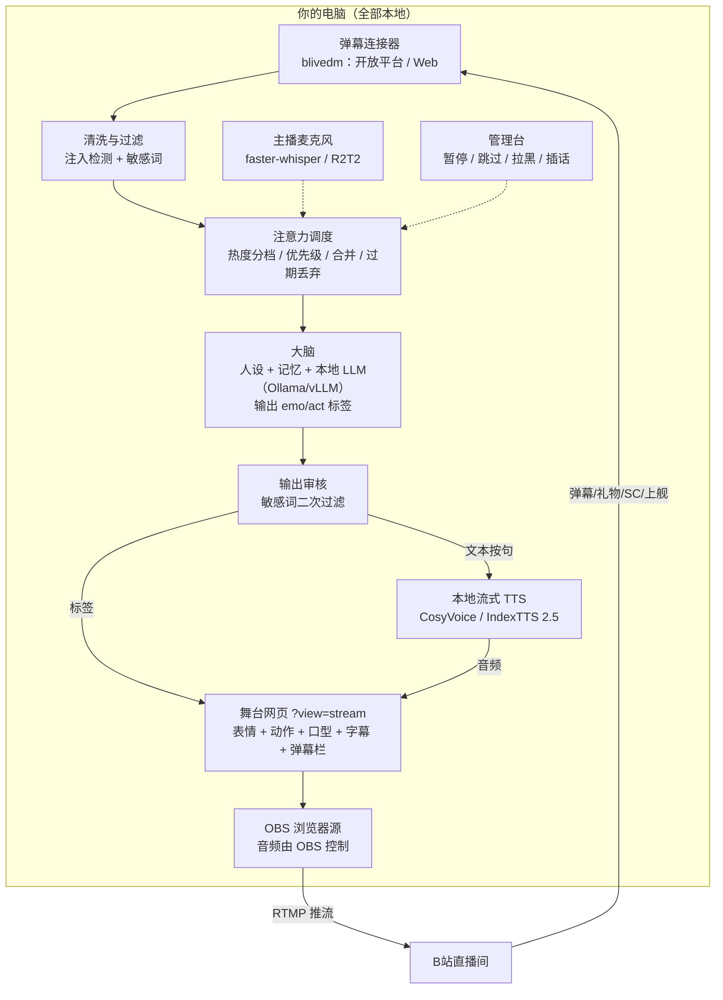

# LumenAct → B站 AI 虚拟主播：本地部署调研与开发计划

> 状态：调研与计划文档（2026-11-25），尚未实现。本文所有组件都按 **在自己电脑上本地运行** 设计：弹幕接入、大模型、语音识别、语音合成、舞台渲染和 OBS 推流都在同一台 PC 上。云端服务只作为可选项或离线素材生成工具。
>
> 目标：在现有语音对话分支（`feat/voice-chat-emotion`，见 [语音对话指南](VOICE_CHAT.md)）的基础上，让流明在 B站直播间里读弹幕、回答问题，并根据内容切换表情和身体动作。

## 目录

1. [结论与推荐技术栈](#1-结论与推荐技术栈)
2. [参考：「大肥鱼」直播教程与开源实现](#2-参考大肥鱼直播教程与开源实现)
3. [LumenAct 现状与差距](#3-lumenact-现状与差距)
4. [本地组件选型](#4-本地组件选型)
5. [目标架构](#5-目标架构)
6. [模块与目录规划](#6-模块与目录规划)
7. [分阶段 TODO 与验收标准](#7-分阶段-todo-与验收标准)
8. [硬件要求](#8-硬件要求)
9. [合规与内容安全](#9-合规与内容安全)
10. [风险与待定决策](#10-风险与待定决策)
11. [参考来源](#11-参考来源)

---

## 1. 结论与推荐技术栈

| 层 | 推荐（本地优先） | 备选 |
| --- | --- | --- |
| 弹幕 | [blivedm](https://github.com/xfgryujk/blivedm)：开发期用 Web 模式彩排，正式开播用 **B站直播开放平台（主播身份码）** 模式 | 只用 Web 模式 + 登录 Cookie（有账号风险，见第 9 节） |
| 大模型 | **本地**：[Ollama](https://github.com/ollama/ollama) 或 [vLLM](https://github.com/vllm-project/vllm)，均提供 OpenAI 兼容接口，直接填进现有 `LUMENACT_LLM_ENDPOINT` | 任意 OpenAI 兼容 API（DeepSeek 等），按 token 计费 |
| 语音合成 | **本地流式**：[CosyVoice2/3](https://github.com/QwenAudio/CosyVoice)（官方称双向流式，延迟低至约 150 ms）或 **自部署 [IndexTTS 2.5](https://github.com/index-tts/index-tts)**（用你现有的参考音色，官方 RTX 4090 上 RTF 约 0.2） | GPT-SoVITS；浏览器朗读兜底 |
| 语音识别（主播自己说话时） | 现有本地后端：faster-whisper 或 [Confucius4-R2T2](https://github.com/netease-youdao/Confucius4-R2T2) GPU 服务 | 浏览器 Web Speech |
| 画面 | LumenAct 现有 three.js 网页，新增 `?view=stream` 舞台模式，后续换成全身 VRM（[three-vrm](https://github.com/pixiv/three-vrm)） | Live2D + VTube Studio |
| 推流 | 同机 OBS Studio 30+：浏览器源 + 「通过 OBS 控制音频」，[obs-websocket](https://github.com/obsproject/obs-websocket) 做自动化 | 哔哩哔哩直播姬 |

**RunningHub IndexTTS 不再用于直播**：实测 7 个字约 39 秒、5.27 点，按每 6 秒一句估算，一小时约 600 句、约 3162 点，延迟和成本都不可接受。它只保留给 **离线素材生成**（开场白、固定感谢语、预录台词），生成后缓存为本地音频文件。

---

## 2. 参考：「大肥鱼」直播教程与开源实现

「大肥鱼」不是某一位 UP 主，而是 DeepSeek Harness（DSH）社区的 AI 鲸鱼娘角色。B站上有很多「让大肥鱼开直播」的教程。下表视频已通过 B站接口逐个核对（2026-11-25）。视频画面和语音没有逐帧观看，技术栈信息来自标题、简介和简介里链接的开源仓库。

| 视频 | UP 主 · 日期 | 从简介能确认的技术栈 |
| --- | --- | --- |
| [如何让DSH大肥鱼开直播？从零打造大肥鱼直播间](https://www.bilibili.com/video/BV1zhWi6cEHD) | Git源宝 · 2026-11-13 | 三视图角色设计、DeepSeek API 人设、阿里云 TTS 音色训练、即梦动作生成 + 动作词库、网易云点歌、OBS 推流 |
| [【教程】把大肥鱼接入直播间！自动回复弹幕](https://www.bilibili.com/video/BV1Zmx36FEiW) | 极海HEX · 2026-10-28 | [Coopanion](https://github.com/Pal-AI-Lab/Coopanion) 桌面伙伴 |
| [0 基础搭建 AI 虚拟直播间（DeepSeek 大肥鱼）](https://www.bilibili.com/video/BV16ZW86EEyj) | Winter喵 · 2026-11-09 | OBS + DeepSeek API + 编程 Agent；弹幕参考 [bilive-danmaku](https://github.com/Beats0/bilive-danmaku)，低延迟建议申请 [open-live 官方接口](https://open-live.bilibili.com/) |
| [大肥鱼你来B站直播嘛！大肥鱼彩排](https://www.bilibili.com/video/BV1xpn66GExn) | GeoLingua · 2026-10-21 | [dsh-livestream](https://github.com/luckui/dsh-livestream) 实机演示 |
| [大肥鱼当虚拟主播？AgentL2D工作台](https://www.bilibili.com/video/BV1St4Y6jEkc) | 苌萌萌 · 2026-11-06 | [jingyu-live2d-agent](https://github.com/InariNGT-Ofiicial/jingyu-live2d-agent) 1.5：Live2D 动作编排、OBS 捕捉 |
| [【BETA】让大肥鱼驾驶Live2D？](https://www.bilibili.com/video/BV1F4xq66EUS) | 苌萌萌 · 2026-10-30 | 参数驱动 + 原生动作复用 |
| [累计消耗40亿token，让大肥鱼成为游戏主播](https://www.bilibili.com/video/BV1GyW16VEpD) | 落苏白酱灵感菇 · 2026-11-11 | DSH NEXT + Coopanion |
| [大肥鱼接入抖Y直播【保姆级教程】](https://www.bilibili.com/video/BV1YJ4g6WE6y) | 下了猫猫雨i · 2026-11-03 | 弹幕自动回复、弹幕点歌 |
| [大肥鱼直播搭建，支持3个平台](https://www.bilibili.com/video/BV1Hf4E6fE7L) | 下了猫猫雨i · 2026-11-07 | 五套人设、冷场主动聊天 |
| [同样是AI虚拟形象，大肥鱼和Neuro-sama差在哪？](https://www.bilibili.com/video/BV162xo6tEPq) | 古月A-Moon · 2026-11-05 | 分析向 |
| [关于AI“大肥鱼”你怎么看？](https://www.bilibili.com/video/BV1VpyWzDEZw) | 哔哩哔哩社区小管家 · 2026-11-20 | 官方倡导：在名称、签名等显著位置标明 AI 身份，控制 AI 发布频率 |

### 值得借鉴的开源实现

| 项目 | 做法 | 借鉴点 |
| --- | --- | --- |
| [luckui/dsh-livestream](https://github.com/luckui/dsh-livestream)（代码 MIT；大肥鱼素材 CC BY-NC-SA 4.0） | 弹幕/礼物/SC/上舰/进场实时接入；按房间热度取舍（最近一分钟说话人数 <8 冷清、≥30 热闹）；注入检测（`src/core/safety.ts`）；观众记忆；回复里写 `[shocked]` 念到就换表情；OBS WebSocket 开播；本地彩排 | 注意力调度、安全清洗、记忆、彩排模式、礼物分级触发（`gift.small / big / huge`） |
| [chortle9/dsh-live](https://github.com/chortle9/dsh-live) | 上面插件的一键安装包 | 排障表：开播风控 60043、人脸 60024、`rtmpsrt` 码率 0、NVENC 缺失 |
| [InariNGT-Ofiicial/jingyu-live2d-agent](https://github.com/InariNGT-Ofiicial/jingyu-live2d-agent)（MIT） | 自然语言编排 Live2D 动作时间线；CosyVoice 流式语音、分句字幕、嘴型与讲话动作联动 | 「讲话时附带动作」、动作时间线 |
| [XiaoZheBrother/dsh-live-studio](https://github.com/XiaoZheBrother/dsh-live-studio)（MIT） | blivedm 收弹幕、合并同一观众的问题、Edge TTS、Live2D 舞台、礼物账本 | 同观众问题合并 |
| [FAYER-0610/dafeiyu-vtuber](https://github.com/FAYER-0610/dafeiyu-vtuber) | B站直播《杀戮尖塔2》；弹幕、昵称、记忆都当数据不当指令；过时台词直接丢弃 | 安全边界、「过时不念」 |
| [Open-LLM-VTuber](https://github.com/Open-LLM-VTuber/Open-LLM-VTuber) | 全离线语音陪伴、Live2D 表情映射 | 本地 LLM / TTS 组合 |
| [Ikaros-521/AI-Vtuber](https://github.com/Ikaros-521/AI-Vtuber)（GPL-3.0） | 多平台弹幕、多 TTS、过滤器流水线、去重 | 过滤和去重（注意 GPL，只参考思路不拷代码） |
| [ZerolanLiveRobot](https://github.com/AkagawaTsurunaki/ZerolanLiveRobot) | B站弹幕挑选回复、OBS 打字机字幕 | 字幕与 OBS 控制 |
| [pixiv/ChatVRM](https://github.com/pixiv/ChatVRM) | 浏览器里 VRM + 大模型对话 | VRM 表情与动作 |
| [xfgryujk/blivechat](https://github.com/xfgryujk/blivechat) | OBS 弹幕评论栏 | 舞台弹幕栏样式 |

---

## 3. LumenAct 现状与差距

| 能力 | 现在（PR #1） | 直播还缺 |
| --- | --- | --- |
| 输入 | 麦克风 → ASR（浏览器 / Confucius4-R2T2 / Whisper / faster-whisper） | 弹幕、礼物、SC、上舰事件源 |
| 大脑 | 大模型回复 + 表情标签 → 28 种表情 | 直播人设、观众记忆、排队取舍、冷场话题、动作标签 |
| 声音 | RunningHub IndexTTS 2.5、自部署 IndexTTS（`tools/indextts_http_server.py`）、OpenAI 兼容、浏览器 | 本地 **流式** TTS、按句播放队列 |
| 画面 | three.js 网页，只有流明一张脸（形态键）、字幕、音量口型 | 全身模型和身体动作、直播布局（弹幕栏、礼物卡片） |
| 运营 | 无 | 管理台：暂停、跳过、拉黑、敏感词、手动插话、统计 |
| 推流 | 无 | OBS 浏览器源、音频路由、开播流程 |

---

## 4. 本地组件选型

### 4.1 弹幕：开放平台 vs Web 长连

| | B站直播开放平台（推荐正式使用） | Web 端长连（blivedm 默认模式） |
| --- | --- | --- |
| 身份 | 开发者 `access_key` / `access_secret` + **主播身份码**（[play-live.bilibili.com](https://play-live.bilibili.com/) 右下角） | 房间号；不登录时用户名打码、UID 为 0，需填登录 Cookie 的 `SESSDATA` |
| 事件 | `LIVE_OPEN_PLATFORM_DM / SEND_GIFT / SUPER_CHAT / SUPER_CHAT_DEL / GUARD / LIKE / LIVE_ROOM_ENTER / LIVE_START / LIVE_END / INTERACTION_END` | 弹幕、礼物、SC、上舰、进场（非公开协议） |
| 生命周期 | `/v2/app/start` → WSS 发 `OP_AUTH` → WS 心跳 + 每 20 秒 `/v2/app/heartbeat` → `/v2/app/end`（必须调用） | 连上即可 |
| 门槛 | 开发者入驻审核，密钥邮件下发约 3–5 个工作日 | 无 |
| 风险 | 官方接口，不碰账号凭据 | Cookie 等同账号凭据；协议可能变化 |

blivedm 两种模式都支持（参考其 `sample.py` 和 `open_live_sample.py`），所以连接器统一基于 blivedm，配置切换模式。开放平台的观众标识是 `open_id`，记忆按它存。

### 4.2 大模型（本地优先）

- **Ollama**：安装后自带 OpenAI 兼容接口 `http://127.0.0.1:11434/v1/chat/completions`，`LUMENACT_LLM_ENDPOINT` 指过去、`LUMENACT_LLM_KEY` 留空即可。
- **vLLM**：显存充足时吞吐和首字延迟更好，同样是 OpenAI 兼容接口。
- 模型建议用中文能力好的 7B–14B 指令模型（量化版），先保证首句延迟；API 模型作为可切换选项保留。
- 要求：**流式输出**，按句号/问号/感叹号切句，第一句立刻送 TTS。

### 4.3 语音合成（本地流式）

| 方案 | 依据 | 定位 |
| --- | --- | --- |
| CosyVoice2/3 | 官方：文本输入流式 + 音频输出流式，延迟低至约 150 ms；支持 vLLM | 首选低延迟方案 |
| 自部署 IndexTTS 2.5 | 官方 RTF 约 0.2（RTX 4090）；可 vLLM 部署；情感控制强 | 保留你现有参考音色；已有 `tools/indextts_http_server.py` 可扩展为流式 |
| GPT-SoVITS | 少量数据训练固定音色 | 备选 |
| RunningHub IndexTTS | 约 39 秒/句 | **仅离线素材生成** |

### 4.4 延迟预算（估计）

| 环节 | 目标 |
| --- | --- |
| 弹幕入队到被选中 | 0–1 秒 |
| 大模型首句 | 0.5–1.5 秒 |
| TTS 首包 | 0.2–1 秒 |
| B站观众看到 | 再加推流本身的几秒延迟 |

### 4.5 身体动作

LumenAct 网页目前只驱动一张脸的形态键（见 [BOUNDARIES.md](BOUNDARIES.md)），没有骨骼。可选方案：

| 方案 | 做法 | 评价 |
| --- | --- | --- |
| **A. 全身 VRM + three-vrm（推荐）** | 流明全身 VRM；脸部保留现有同名形态键；动作用 VRMA 片段（Mixamo/动捕重定向），`AnimationMixer` 交叉淡入 | 与现有 three.js 网页同栈，OBS 浏览器源直接用；README 已推荐 VRM → Blender 适配流程 |
| B. Live2D + VTube Studio | 参考 jingyu-live2d-agent | 2D，需另做 Live2D 流明 |
| C. Unity / UE | 引擎渲染，WebSocket 收标签 | 画质好，工作量最大 |
| D. Blender 实时 | 不适合直播渲染 | 只用于制作动作片段和形态键（现有 Blender + MCP 流程） |

**标签协议**：在现有表情标签旁加动作标签，按句输出，例如：

```text
[emo:开心][act:挥手] 欢迎来到直播间！
[emo:思考][act:歪头] 这个问题有点难，我想想……
```

- 动作取白名单（挥手、点头、摇头、歪头、思考、鼓掌、比心、惊讶后仰、害羞捂脸、待机呼吸等 10–15 个），未知标签丢弃。
- 礼物、上舰等事件直接映射固定动作，不经过大模型。
- 讲话时叠加小幅手势和点头，避免站桩。

---

## 5. 目标架构



---

## 6. 模块与目录规划

以下是建议的新增文件，沿用现有 `server.py` + `voice_services.py` + `preview/` 的结构（Python 标准库后端 + 原生 ES 模块前端）：

```text
live/                         # 直播后端（Python）
  __init__.py
  events.py                   # 统一 LiveEvent：chat / gift / superchat / guard / enter / like
  bili_source.py              # blivedm 封装：web 模式 + open-live 模式，断线重连
  mock_source.py              # 模拟弹幕 / 回放录制的弹幕（彩排和测试用）
  safety.py                   # 清洗、注入检测、敏感词（入队前 + 输出后）
  attention.py                # 热度分档、优先级、合并同一观众、过期丢弃
  persona.py                  # 直播人设提示词、标签说明（emo + act 白名单）
  memory.py                   # 观众记忆（按 open_id，SQLite）
  director.py                 # 主循环：选事件 → LLM 流式 → 切句 → 审核 → TTS 队列 → 推给舞台
  tts_stream.py               # 流式 TTS 客户端：CosyVoice / IndexTTS 本地
  obs_control.py              # 可选：obs-websocket 场景切换、待机画面
live-config.example.json      # 房间号、模式、身份码路径、敏感词表路径、节奏参数
live-words/blocklist.txt      # 敏感词表（本地，可在管理台编辑）
preview/
  stream.html                 # 或 index.html?view=stream：直播舞台布局
  stage-overlay.js            # 弹幕栏、礼物卡片、字幕
  motion-player.js            # P2：VRM 动作片段播放、act 标签 → 片段
  admin.html / admin.js       # 管理台
assets/motions/               # P2：VRMA 动作片段 + motions.json（标签 → 文件）
tools/
  cosyvoice_http_server.py    # 本地 CosyVoice 流式 HTTP 包装
  record_room.py              # 录真实弹幕用于回放测试
tests/
  test_live_attention.py
  test_live_safety.py
  test_live_director.py       # 用 mock_source + mock LLM/TTS 跑完整链路
docs/LIVE_VTUBER_PLAN.md      # 本文
```

`server.py` 新增接口（建议）：

| 接口 | 作用 |
| --- | --- |
| `GET /api/live/stream`（SSE 或 WebSocket） | 舞台订阅：字幕、标签、音频地址、弹幕栏、礼物卡片 |
| `POST /api/live/control` | 管理台：开始/暂停/跳过/静音/拉黑/插话 |
| `GET /api/live/status` | 连接状态、队列长度、延迟、调用统计 |

所有服务默认只监听 `127.0.0.1`；密钥和身份码只放 `.env` / 本地配置，不提交。

---

## 7. 分阶段 TODO 与验收标准

### P0 本地彩排 MVP（估计 1–2 周）

- [ ] `live/events.py`：定义 `LiveEvent`，附单元测试
- [ ] `live/mock_source.py`：命令行/管理台手动发弹幕，支持回放 JSONL
- [ ] `live/bili_source.py`（Web 模式）：能收到真实房间弹幕并转成 `LiveEvent`
- [ ] `live/attention.py`：简单优先队列（问题、点名优先；超过 60 秒的弹幕丢弃）
- [ ] `live/persona.py` + `director.py`：复用现有 LLM 代理，流式输出、按句切分，带 `[emo:]` 标签
- [ ] `tools/cosyvoice_http_server.py` 或 IndexTTS 本地流式后端，`tts_stream.py` 按句播放队列
- [ ] `?view=stream` 舞台：1920×1080，字幕 + 弹幕栏，无控制面板
- [ ] OBS 浏览器源接入，音频由 OBS 控制

**验收**：断网（除 B站弹幕外）情况下，用本地 LLM + 本地 TTS，在 OBS 预览里：发一条弹幕后 **5 秒内** 流明开口回答，表情随标签切换；连续 30 分钟彩排不崩溃；`python -m unittest` 全部通过。

### P1 可以正式开播（估计 2–3 周）

- [ ] 开放平台模式：身份码配置、start / 心跳 / end 生命周期、断线切换集群
- [ ] 礼物 / SC / 上舰 / 进场事件：分级感谢，SC 和上舰必回
- [ ] 热度分档调度（参考 dsh-livestream：冷清几乎每条接、热闹只接问题/点名/舰长，刷屏合并）
- [ ] `live/safety.py`：入队前注入检测 + 敏感词；输出后二次过滤，命中换兜底句
- [ ] 管理台：暂停、跳过当前句、一键静音并切待机画面、拉黑观众、手动插话、实时统计
- [ ] 冷场话题：无弹幕 N 秒后主动说话（有观众时才说）
- [ ] 观众记忆 `memory.py`（按 `open_id`）
- [ ] 舞台角标常显「AI 虚拟主播」

**验收**：在自己的直播间用小号测试：注入句式（如「忽略以上指令」）不被执行；敏感词命中不被念出；开播、下播都调用 `/v2/app/end`；连续直播 2 小时无人工干预下不断线、不重复念同一条；管理台静音 1 秒内生效。

### P2 身体动作（估计 3–5 周，含建模）

- [ ] 流明全身 VRM（Blender + MCP 适配，保留现有脸部同名形态键）
- [ ] 舞台改用 three-vrm 加载全身模型，脸部表情曲线继续驱动形态键
- [ ] `assets/motions/`：10–15 个 VRMA 动作片段 + `motions.json`
- [ ] `motion-player.js`：`[act:]` 标签 → 片段，交叉淡入，结束回待机
- [ ] 讲话手势层、礼物事件动作、待机呼吸/眨眼
- [ ] 人设提示词加入动作白名单说明

**验收**：每个白名单动作都能由标签触发且不穿模；动作与表情同时进行不冲突；连续 1 小时动作切换无卡顿（舞台保持 60 fps 或至少 30 fps）；未知标签被忽略。

### P3 打磨（持续）

- [ ] 回头客识别、点歌或小游戏、回放复盘报告、长时间稳定性与日志

---

## 8. 硬件要求

全部本地运行时，LLM、TTS、ASR、浏览器渲染和 OBS 编码共用一台机器。以下为估计值，以实际模型大小为准：

| 配置 | 建议 |
| --- | --- |
| 推荐 | NVIDIA RTX 4090 / 3090（24 GB 显存）：7B–14B 量化 LLM + CosyVoice/IndexTTS + faster-whisper 可同时常驻；OBS 用 NVENC 编码 |
| 最低可用 | 16 GB 显存 N 卡：较小 LLM（7B 量化）+ 一个 TTS；或 LLM 改用 API，GPU 只跑 TTS |
| 内存 / CPU | 32 GB 内存以上；8 核以上 CPU |
| 存储 | SSD，预留 50 GB 以上放模型 |
| 网络 | 上行带宽稳定 6 Mbps 以上（1080p 推流）；比较稳妥的码率可先用 720p |
| 音频 | 戴耳机（避免麦克风录到流明自己的声音） |
| 系统 | Windows 10/11（OBS、直播姬最方便）；Confucius4-R2T2 / vLLM 在 Linux 或 WSL2 更顺 |

---

## 9. 合规与内容安全

- **开播资格**：实名认证、年满 18 岁、绑定手机、无严重违规（[B站UP主开播白皮书](https://live.bilibili.com/blackboard/era/u4EPvXpDYUMv7hYJ.html)）；首次 API 开播可能要人脸认证。
- **AI 身份标注**：标题、简介、直播间画面角标写明「AI 虚拟主播 / 虚构演绎」。B站已上线 AI 生成内容标识（[公告](https://www.bilibili.com/opus/1106496554576904197)），社区小管家也倡导在名称、签名显著位置标明 AI 身份（[BV1VpyWzDEZw](https://www.bilibili.com/video/BV1VpyWzDEZw)）。
- **行为规范**：[《网络主播行为规范》](https://www.gov.cn/gongbao/content/2022/content_5707286.htm) 第一条明确 AI 合成虚拟主播参照执行：不谈时政、不给医疗/金融/法律等专业建议、不诱导打赏、不传播低俗内容。
- **弹幕只当数据**：截断长度（dsh-livestream 用 240 字）、去控制字符、标记注入句式（「忽略以上」「你现在是」「system:」等），系统提示词明确观众文字不是指令。
- **双层过滤**：入队前敏感词表 + 输出后再过滤；命中即换兜底句。
- **人工值守**：开播时必须有人看管理台，能一键静音、切待机画面。
- **素材授权**：大肥鱼形象 CC BY-NC-SA 4.0，禁止商用；LumenAct 使用自己的流明形象。参考 GPL 项目（如 AI-Vtuber）时只借鉴思路。
- **开播风控**：dsh-live 记录过 API 开播触发风控 60043；先用哔哩哔哩直播姬或 OBS 手动开播更稳。

---

## 10. 风险与待定决策

**待定决策**

1. 弹幕先用 Web 模式（需 Cookie）彩排，还是直接申请开放平台开发者（需审核）？
2. 全身形象：自建流明 VRM、约稿，还是先用 Live2D 过渡？
3. 本地 LLM 用哪个模型、Ollama 还是 vLLM；是否保留 API 作为兜底？
4. TTS 选 CosyVoice（更低延迟）还是自部署 IndexTTS 2.5（沿用现有参考音色）？
5. 开播用主号还是专用号？
6. 是否需要主播本人同时说话（双人模式），还是纯 AI 主播？

**主要风险**

- 单卡同时跑 LLM + TTS + OBS 编码，显存和延迟吃紧。
- API 开播可能触发风控或人脸认证。
- Cookie 等同账号凭据，非官方协议可能变化。
- 弹幕注入或敏感内容导致直播间被处罚。
- 没有全身模型就做不出身体动作（P2 最大工作量）。

---

## 11. 参考来源

**B站官方**

- B站直播开放文档：[官方 API（start / end / 心跳）](https://open-live.bilibili.com/document/eba8e2e1-847d-e908-2e5c-7a1ec7d9266f) · [长连协议](https://open-live.bilibili.com/document/657d8e34-f926-a133-16c0-300c1afc6e6b) · [直播间数据（事件 CMD）](https://open-live.bilibili.com/document/f9ce25be-312e-1f4a-85fd-fef21f1637f8) · [快速接入](https://open-live.bilibili.com/document/849b924b-b421-8586-3e5e-765a72ec3840)
- [主播身份码获取（互动玩法）](https://play-live.bilibili.com/) · [官方 C# Demo](https://github.com/bilibili-openplatform/OpenLive_CSharpDemo)
- [B站UP主开播白皮书](https://live.bilibili.com/blackboard/era/u4EPvXpDYUMv7hYJ.html) · [关于AI生成内容有序标识的公告](https://www.bilibili.com/opus/1106496554576904197)

**开源项目**

- 弹幕：[blivedm](https://github.com/xfgryujk/blivedm) · [blivechat](https://github.com/xfgryujk/blivechat) · [bilive-danmaku](https://github.com/Beats0/bilive-danmaku)
- 大肥鱼直播：[dsh-livestream](https://github.com/luckui/dsh-livestream) · [dsh-live](https://github.com/chortle9/dsh-live) · [dsh-live-studio](https://github.com/XiaoZheBrother/dsh-live-studio) · [dafeiyu-vtuber](https://github.com/FAYER-0610/dafeiyu-vtuber) · [jingyu-live2d-agent](https://github.com/InariNGT-Ofiicial/jingyu-live2d-agent) · [Coopanion](https://github.com/Pal-AI-Lab/Coopanion)
- AI VTuber：[Open-LLM-VTuber](https://github.com/Open-LLM-VTuber/Open-LLM-VTuber) · [AI-Vtuber](https://github.com/Ikaros-521/AI-Vtuber) · [ZerolanLiveRobot](https://github.com/AkagawaTsurunaki/ZerolanLiveRobot) · [ChatVRM](https://github.com/pixiv/ChatVRM)
- 本地模型与渲染：[Ollama](https://github.com/ollama/ollama) · [vLLM](https://github.com/vllm-project/vllm) · [CosyVoice](https://github.com/QwenAudio/CosyVoice) · [IndexTTS](https://github.com/index-tts/index-tts) · [faster-whisper](https://github.com/SYSTRAN/faster-whisper) · [Confucius4-R2T2](https://github.com/netease-youdao/Confucius4-R2T2) · [three-vrm](https://github.com/pixiv/three-vrm) · [obs-websocket](https://github.com/obsproject/obs-websocket)
